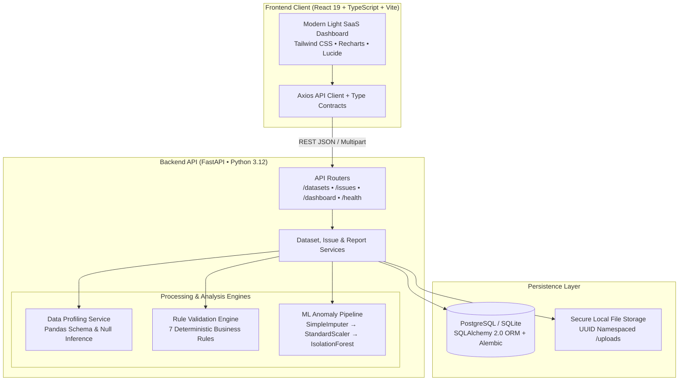

# SentinelAI — Intelligent Data Quality & Anomaly Detection Platform

[](https://github.com/shivam/sentinelai/actions/workflows/ci.yml)
[](https://www.python.org/downloads/)
[](https://fastapi.tiangolo.com/)
[](https://react.dev/)
[](https://scikit-learn.org/)
[](https://opensource.org/licenses/MIT)

**SentinelAI** is an enterprise-grade, production-style platform that safeguards operational and financial analytics by intercepting malformed records and detecting multivariate anomalies *before* they corrupt business decisions.

It pairs a high-throughput **deterministic validation engine** (structural formatting, domain bounds, duplicate detection) with an **unsupervised machine learning pipeline (Scikit-learn Isolation Forest)** to identify subtle outliers that rule-based checks miss.

---

## 🏛️ System Architecture



---

## ⚡ Key Modules & Capabilities

### 1. Dataset Ingestion & Automatic Profiling
- **Safe Uploads:** Accepts CSV files up to 50MB, enforces RFC mime validation, validates headers, and prevents path traversal using UUID-based sanitized storage filenames.
- **Statistical Profiling:** Computes per-column data types, completeness percentages, unique counts, sample values, and descriptive statistics (`min`, `max`, `mean`, `std`, `median`, `q25`, `q75`).
- **Data Preservation:** Original dataset files are stored immutable—transformations and evaluations are strictly non-destructive.

### 2. Rule-Based Data Quality Engine
Executes configurable deterministic rules across records:
- **`MissingValueCheck`:** Evaluates completeness. Flags missing rows with tiered severity (`<5%` low, `<20%` medium, `<50%` high, `≥50%` critical).
- **`DuplicateRowCheck`:** Identifies exact duplicate rows across all fields (`high` severity).
- **`DateFormatCheck`:** Tests parseability of temporal fields against ISO-8601 and common datetime specifications.
- **`EmailFormatCheck`:** Validates RFC 5322 compliant email formatting.
- **`NegativeValueCheck`:** Detects invalid negative numbers in financial fields (`amount`, `price`, `salary`).
- **`OutOfRangeCheck`:** Enforces percentage and probability domain boundaries `[0, 100]`.
- **`CategoryConsistencyCheck`:** Detects rare single-occurrence categories in low-cardinality categorical fields (potential typographical errors).

Every issue includes:
`dataset_id`, `row_index`, `column_name`, `rule_name`, `actual_value`, `expected_condition`, `severity`, `explanation`, and `suggested_action`.

### 3. Machine Learning Anomaly Detection (Isolation Forest)
- **Feature Selection:** Automatically discovers eligible continuous numerical features (excluding IDs, dates, target labels, and static variance columns).
- **Explicit Preprocessing:** `SimpleImputer(strategy="median")` $\rightarrow$ `StandardScaler()`.
- **Isolation Forest Model:** Configured with `contamination=0.05` and fixed deterministic `random_state=42`.
- **Statistical Feature Explanations:** For each flagged record, computes empirical feature $z$-scores relative to dataset baselines ($z = \frac{x - \mu}{\sigma}$) to pinpoint which dimensions drove statistical isolation.
- **Honest ML Guidance:** The platform clearly distinguishes empirical $z$-scores from formal causal or SHAP explanations, and maintains that an unusual transaction is not automatically fraud.

### 4. Issue Management Studio & Persistent Audit Trail
- Filter and prioritize findings by severity (`critical`, `high`, `medium`, `low`), detector, and status.
- Transition lifecycle status: `open` $\rightarrow$ `investigating` $\rightarrow$ `resolved` / `ignored`.
- Record timestamped investigation notes by analyst.
- Maintains an append-only `audit_events` ledger recording who changed what, when, and previous values.

### 5. Executive Dashboard & Analytics
- Live aggregation computed directly from persisted database records.
- KPI cards for datasets, examined records, quality violations, and ML anomalies.
- Visual distribution of issues by severity and 30-day issue ingestion velocity using **Recharts**.

### 6. Exportable Audit Reports
- One-click CSV report export containing full issue details, rule specifications, detector attribution, and suggested corrective actions.

---

## 🔬 ML Evaluation & Synthetic Benchmark

To rigorously benchmark the anomaly detection pipeline, a synthetic financial transaction dataset with known injected ground-truth anomalies was generated (`data/synthetic/generate_transactions.py`):

- **Total records:** 2,010 transactions
- **Known anomalies injected:** 100 (4.98% contamination rate)
- **Anomaly types injected:**
  1. *Extreme amount outliers* (lognormal with elevated parameters)
  2. *Unusual hour + high amount* (middle-of-night transactions exceeding \$5,000)
  3. *Velocity spikes* (account velocity $>15$ daily transactions with high values)
  4. *Customer age inconsistencies* (negative or $>100$ years)
- **Data quality issues injected:** Missing amounts, duplicate rows, negative prices, and invalid email domains.

### Offline Benchmark Results (`IsolationForest`, contamination=0.05, seed=42)

| Metric | Score | Interpretation |
|---|---|---|
| **ROC AUC** | **0.9368** | Exceptional ranking discriminability across threshold spectrum |
| **Anomaly F1-Score** | **0.6070** | Harmonic mean of precision and recall on minority class |
| **Precision (Anomaly)** | **60.4%** | 61 of 101 flagged transactions were confirmed injected anomalies |
| **Recall (Anomaly)** | **61.0%** | Caught 61 out of 100 known anomalies in unsupervised setting |
| **True Negatives** | 1,870 | Correctly classified normal transactions |
| **False Positives** | 40 | Normal transactions flagged due to joint multivariate deviation |
| **False Negatives** | 39 | Injected subtle anomalies that fell within joint empirical density |

> **Methodology Caveat:** This evaluation is conducted on synthetic data with known generation mechanics. While an unsupervised ROC AUC of 0.94 is strong, synthetic benchmarks do not guarantee identical performance on real-world transaction distributions with non-stationary drift.

To regenerate and re-evaluate the benchmark:
```bash
python data/synthetic/generate_transactions.py
python scripts/evaluate_ml.py
```

---

## 🛠️ Technology Stack

| Layer | Technologies |
|---|---|
| **Backend** | Python 3.12, FastAPI, SQLAlchemy 2.0, Alembic, Pydantic v2, Pandas, NumPy, Scikit-learn |
| **Frontend** | React 19, TypeScript, Vite, Tailwind CSS v4, Recharts, Lucide Icons, Axios |
| **Storage** | PostgreSQL 16 (production) / SQLite (zero-config local development) |
| **Infrastructure** | Docker, Docker Compose, GitHub Actions CI/CD |

---

## 🚀 Quickstart & Installation

### Option A: Local Development (Fastest, Zero Docker Required)

#### 1. Backend Setup
```bash
# Navigate to backend directory
cd backend

# Create virtual environment (Python 3.12 recommended)
python -m venv .venv
# Windows:
.venv\Scripts\activate
# Linux/macOS:
# source .venv/bin/activate

# Install dependencies
pip install -r requirements.txt

# Run database tables & start FastAPI server
uvicorn main:app --reload --port 8000
```
The FastAPI backend will start at `http://localhost:8000`.  
Interactive Swagger docs available at `http://localhost:8000/docs`.

#### 2. Frontend Setup
```bash
# In a new terminal, navigate to frontend
cd frontend

# Install npm packages
npm install

# Start Vite development server
npm run dev
```
The React frontend dashboard will open at `http://localhost:5173`.

---

### Option B: Docker Compose (Full Stack with PostgreSQL)

```bash
# Clone the repository
git clone https://github.com/shivam/sentinelai.git
cd sentinelai

# Start database, backend, and frontend containers
docker-compose up --build
```
- Frontend UI: `http://localhost:3000`
- FastAPI REST API: `http://localhost:8000`
- PostgreSQL: `localhost:5432`

---

## 🧪 Testing & Verification

### Run Automated Backend Test Suite
```bash
cd backend
python -m pytest tests/ -v
```
All **45 unit tests** covering upload validation, rule checks, ML pipelines, issue state transitions, and dashboard metrics run in $<5$ seconds.

### Run End-to-End Platform Verification
Executes the full automated workflow (Health $\rightarrow$ Upload 2,010-row dataset $\rightarrow$ Profiling $\rightarrow$ Rule Engine $\rightarrow$ Isolation Forest $\rightarrow$ Issue Triage $\rightarrow$ Audit Logging $\rightarrow$ Analytics $\rightarrow$ CSV Report Export):
```bash
python scripts/verify_platform.py
```

---

## 📡 REST API Reference

| Method | Endpoint | Description |
|---|---|---|
| `GET` | `/health` | Health check and database connectivity status |
| `POST` | `/api/datasets/upload` | Upload CSV dataset (multipart/form-data) with auto-profiling |
| `GET` | `/api/datasets` | Paginated list of uploaded datasets |
| `GET` | `/api/datasets/{id}` | Detailed dataset metadata and column profiles |
| `POST` | `/api/datasets/{id}/validate` | Run rule-based data quality engine |
| `POST` | `/api/datasets/{id}/detect-anomalies` | Run Scikit-learn Isolation Forest ML pipeline |
| `GET` | `/api/datasets/{id}/issues` | Filterable list of issues (by severity, status, column) |
| `GET` | `/api/datasets/{id}/anomalies` | Paginated anomaly scores with feature $z$-scores |
| `PATCH` | `/api/issues/{id}` | Update issue status (`investigating`, `resolved`) & add note |
| `GET` | `/api/issues/{id}/notes` | Fetch analyst investigation notes for an issue |
| `GET` | `/api/issues/{id}/audit` | Fetch append-only audit trail for an issue |
| `GET` | `/api/dashboard/stats` | Aggregate executive KPI metrics & severity distribution |
| `GET` | `/api/dashboard/trends` | 30-day timeline of issue ingestion |
| `GET` | `/api/datasets/{id}/report` | Download complete issue audit report as CSV |

---

## 🛡️ Security & Reliability Engineering

- **Path Traversal Protection:** User-supplied filenames are sanitized with UUIDv4 prefixes and checked against resolved canonical storage directory paths.
- **Parameterized SQL:** All queries are constructed through SQLAlchemy 2.0 ORM expressions, preventing SQL injection vulnerabilities.
- **Resource Guardrails:** Enforces 50MB file size limits and caps issue database generation at 500 records per run to prevent memory exhaustion from corrupt datasets.
- **CORS Allowlist:** Origins restricted via `ALLOWED_ORIGINS` environment configuration.
- **Zero-Secret Commits:** Configuration isolated in `.env` with a sanitized `.env.example` template.

---

## ⚖️ Production Limitations & Roadmap

- **Authentication:** This portfolio edition is intentionally unauthenticated for frictionless demonstration and local evaluation. A production deployment should incorporate JWT Bearer tokens or OAuth2/SSO with role-based access control (RBAC: Admin vs. Analyst vs. Auditor).
- **Streaming Ingestion:** While the current engine processes batches up to 50MB in-memory using Pandas and Scikit-learn, enterprise-scale streaming ($>1\text{ GB}$) would leverage Apache Kafka, Polars, or distributed Spark workers.
- **Online Learning:** The Isolation Forest fits per batch; streaming architectures would utilize streaming half-space trees or serialized models updated via scheduled drift retraining.

---

## 📄 License

This project is licensed under the MIT License — see the [LICENSE](LICENSE) file for details.
