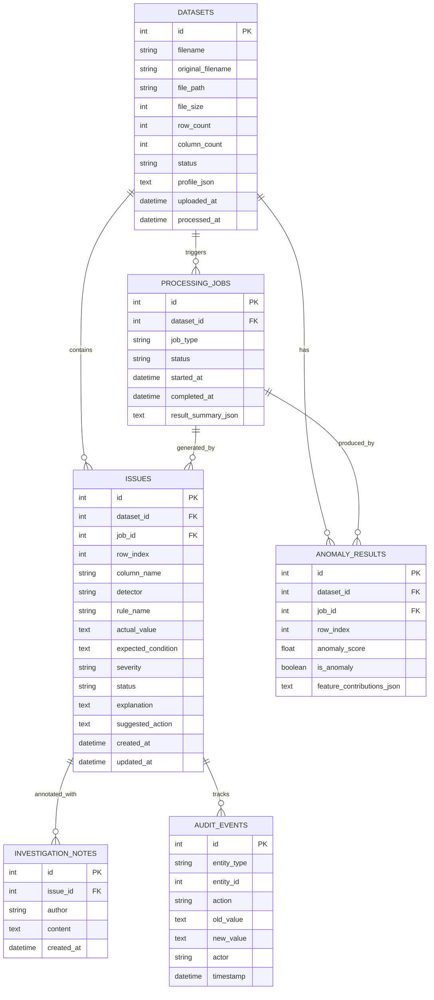

# SentinelAI Architecture & Engineering Design

This document details the software architecture, data modeling, ML pipeline, and security decisions implemented in SentinelAI.

---

## 1. Architectural Philosophy

SentinelAI is built as a **hybrid data quality and anomaly detection platform**:
1. **Deterministic Layer (Rule-Based):** Solves known data corruption modes (nulls, duplicates, invalid formats, domain boundaries) with sub-second determinism and prescriptive corrective actions.
2. **Statistical ML Layer (Unsupervised Anomaly Detection):** Solves unknown or complex multivariate outliers using Scikit-learn's Isolation Forest algorithm without requiring labeled ground truth.
3. **Investigation & Governance Layer:** Turns raw model flags into actionable operational findings with analyst notes and audit trails.

---

## 2. Database Schema Design (SQLAlchemy 2.0 ORM)

### Entities & Relationships

---

## 3. Machine Learning Pipeline Design

### Feature Selection & Preprocessing
1. **Eligible Features:** Selected by querying `df.select_dtypes(include=[np.number])`. Columns with static zero-variance or identifying column names (`id`, `uuid`, `key`) are filtered out.
2. **Missing Value Imputation:** Handled using `SimpleImputer(strategy="median")` to ensure numeric stability against outlier distortion during mean calculations.
3. **Standardization:** Transformed via `StandardScaler()` to ensure features with differing numeric scales (e.g. `amount` vs `hour_of_day`) contribute equitably to geometric path length partitioning.
4. **Isolation Forest Hyperparameters:**
   - `n_estimators = 100`
   - `contamination = 0.05` (5% expected outlier distribution)
   - `random_state = 42` (deterministic random partition seeds)

### Interpretable Feature Deviations
Since Isolation Forest is an unsupervised tree-based ensemble, it does not natively provide per-sample directional feature contributions. 

To provide intuitive diagnostic context without making false claims of "formal model explanations":
- We calculate empirical $z$-scores:
  $$z_{i,j} = \frac{x_{i,j} - \mu_j}{\sigma_j}$$
- For flagged records ($is\_anomaly = True$), feature deviations with $|z| \ge 1.5$ are attached in `feature_contributions_json`.
- The UI explicitly renders these as statistical standard deviations from the dataset baseline.

---

## 4. Security & Guardrails

- **Safe Upload Directory Isolation:** Files are written to an isolated directory outside the web server root.
- **Filename Sanitization:** Uploaded files receive a cryptographically random UUIDv4 prefix: `{uuid4().hex}_{original_name[:50]}.csv`.
- **Safe SQL Parameterization:** All queries use SQLAlchemy ORM expressions; zero raw string SQL interpolation exists in the codebase.
- **Volume Limits:** Maximum upload size default is 50MB; rule evaluation is capped at 500 issues per run to guard against database denial of service from intentionally malformed files.
